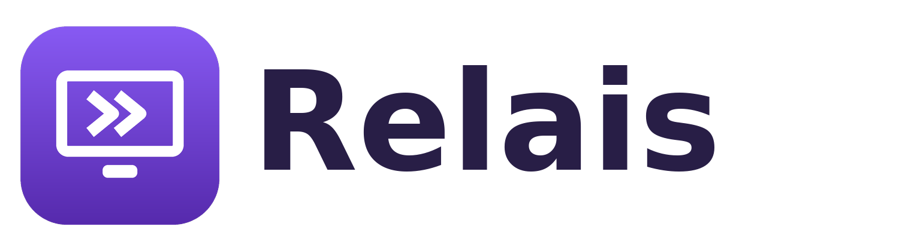

<p align="center"><picture><source media="(prefers-color-scheme: dark)" srcset="docs/logo-dark.png"></picture></p>

Relais is a small Windows app that shows a capture card (Xbox, PlayStation, Switch, any HDMI source) in fullscreen with as little delay as possible, so you can play a console on a PC monitor. It was made to put **frame generation** on console games: the picture is shown by a real Direct3D 11 exclusive-fullscreen window, which is what AMD Fluid Motion Frames (AFMF) needs on Radeon RX 6000 cards, and it can skip the repeated frames of a 30 FPS game captured at 60 FPS so the frame generator gets a clean 30 FPS cadence to double.

The interface is in French. It is a single `.exe` with no installer and no dependencies (Windows 10 or 11, 64-bit).

> [!NOTE]
> First release. AFMF is a driver feature, and AMD does not document whether it accepts a capture viewer. Relais does everything the driver asks for (DirectX 11, exclusive fullscreen, a steady frame rate), but it needs testing on real hardware. Reports are welcome in the issues.

---

## Features

- **Low latency**: the frame goes from the card to the screen with no buffering. Capture runs on its own high-priority thread, Media Foundation is opened in low-latency mode, and YUV frames (NV12, YUY2) are uploaded as they are and converted to RGB on the GPU.
- **Choose the card and its format**: every video device and every resolution / frame rate / pixel format it offers (MJPG, NV12, YUY2...). 1080p at 60 FPS is picked by default.
- **Sound**: plays the card's audio input on your default speakers with about 30 ms of buffer, dropping old audio instead of drifting behind.
- **Colours**: range (Auto, Limited 16-235, Full 0-255) and matrix (Auto, BT.601, BT.709) to fix grey blacks or crushed blacks, plus brightness, contrast, saturation and sharpness, all done in a shader.
- **Duplicate frame skipping**: a 30 FPS game captured at 60 FPS sends each picture twice. Relais compares each frame with the previous one and only presents the new ones, so AFMF or Lossless Scaling interpolate between two different pictures instead of two copies.
- **Two display modes**: exclusive fullscreen (for AFMF) or a borderless window (for Lossless Scaling, OBS, screenshots).
- **Settings are remembered** in `%APPDATA%\Relais\relais.ini`. The last session's real numbers (frames received, frames shown, duplicates skipped) are shown in the window when you come back.

## Download and run

1. Download `relais.exe` from the [Releases](../../releases) page.
2. Plug in the capture card, close OBS, Discord or any app that uses it.
3. Run `relais.exe`, pick the card, the format and the sound input, then click **Lancer**.
4. Press **Échap** to come back to the window.

Windows SmartScreen may warn about an unknown publisher the first time: click "Informations complémentaires", then "Exécuter quand même".

## Frame generation

### AFMF (AMD Radeon RX 6000 and newer)

1. In AMD Software: Adrenalin Edition, open **Gaming > Graphics** and turn on **AMD Fluid Motion Frames**. On RX 6000 cards AFMF only works in exclusive fullscreen.
2. In Relais, keep **Plein écran exclusif** checked.
3. For a game that runs at 30 FPS on the console, capture at 60 FPS and keep **Ignorer les images en double** checked: Relais then shows 30 new frames per second and AFMF brings it to 60.
4. Check that AFMF is active with the Adrenalin overlay (Ctrl+Shift+O).

### Lossless Scaling

Uncheck **Plein écran exclusif** to get a borderless window, then use Lossless Scaling's frame generation (LSFG) on the Relais window. Keep duplicate skipping on for 30 FPS games.

## Settings

| Setting | What it does |
|---|---|
| Vidéo / Format | The capture device and the mode it sends. Prefer 1920 x 1080 @ 60 fps. |
| Son | The card's audio input (often called "Digital Audio Interface" or the card's name). "Aucun" for no sound. |
| Plage de couleurs | Auto reads it from the stream. **Limitée** if blacks look grey and washed out, **Pleine** if blacks are crushed. |
| Matrice | Auto: BT.601 for MJPG (JPEG) cards, BT.709 for HD YUV. Change it if skin tones or reds look off. |
| Luminosité, Contraste, Saturation, Netteté | Picture adjustments on the GPU, no cost in latency. |
| Plein écran exclusif | Real exclusive fullscreen at your monitor's resolution and refresh rate. Needed by AFMF on RX 6000. |
| VSync | Removes tearing, adds up to one refresh of delay. Off by default. |
| Ignorer les images en double / Seuil | Skips frames that are nearly identical to the previous one. Raise the threshold if your card's compression noise stops duplicates from being detected (the "affichées" number stays at 60 for a 30 FPS game); lower it if real frames are skipped. |

### Keys in fullscreen

| Key | Action |
|---|---|
| Échap | Back to the window |
| D | Duplicate skipping on / off |
| R | Next colour range (Auto, Limited, Full) |
| M | Next matrix (Auto, BT.601, BT.709) |
| + / - | Brightness |
| V | VSync on / off |
| Alt+Entrée | Leave / re-enter exclusive fullscreen (exclusive mode only) |

## How it works

```
Capture card ──USB──▶ Media Foundation source (format chosen by the user, low-latency mode)
                         │  MJPG is decoded to NV12/YUY2, NV12/YUY2 pass through untouched
                         ▼
                 capture thread ── packs rows, compares with the previous frame (96 x 54 samples)
                         │           duplicate? ─▶ dropped
                         ▼ newest frame only, never queued
                 render thread ── uploads Y/UV planes to GPU textures
                         │
                         ├─ pass 1 (pixel shader): YUV ─▶ RGB with the chosen range and matrix
                         └─ pass 2 (pixel shader): scaling, letterboxing, brightness, contrast, saturation, sharpness
                                  ▼
                 DXGI swap chain: exclusive fullscreen (blt model) or borderless window (flip model)

Audio input ──▶ Media Foundation (float PCM) ──▶ WASAPI shared mode, default speakers, ~30 ms max queue
```

| File | Content |
|---|---|
| `src/main.cpp` | launcher window, settings file, starting a session |
| `src/video.cpp` | device and format enumeration, Media Foundation capture |
| `src/render.cpp` | capture thread, duplicate detection, Direct3D 11 renderer, fullscreen window, hotkeys |
| `src/shaders.h` | HLSL for the two passes, compiled at start with `d3dcompiler_47.dll` |
| `src/audio.cpp` | audio passthrough |
| `res/` | icon, manifest (visual styles, DPI awareness), version info |

## Building

**Windows (Visual Studio 2022 or newer)**

```
cmake -B build -A x64
cmake --build build --config Release
```

**Linux or macOS (cross-compile with Zig)**

```
pip install ziglang
./build.sh
```

Both give `build/relais.exe`. Every push to `main` is also built by GitHub Actions.

## Limitations

- HDR capture is shown as SDR.
- The duplicate detector looks at the picture, so a static screen (menu, pause) is also seen as duplicates: nothing new is shown, which is invisible on screen.
- Cheap USB 2.0 capture sticks send compressed MJPG, which adds a few milliseconds of decoding and some noise in dark areas.

## License

MIT. See [LICENSE](LICENSE).
