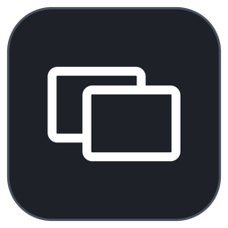

<p align="center"></p>

<h1 align="center">Relais</h1>

<p align="center">Play your console on your PC screen, with as little delay as possible.</p>

Relais is a small Windows app that shows a capture card (Xbox, PlayStation, Switch, any HDMI source) in fullscreen with as little delay as possible, so you can play a console on a PC monitor. It was made to put **frame generation** on console games: the picture is shown by a real Direct3D 11 exclusive-fullscreen window, which is what AMD Fluid Motion Frames (AFMF) needs on Radeon RX 6000 cards, and it can skip the repeated frames of a 30 FPS game captured at 60 FPS so the frame generator gets a clean 30 FPS cadence to double.

The interface is in English and French: Relais asks on first launch, and you can switch at any time from the menu at the top right. It is a single `.exe` with no installer and no dependencies (Windows 10 or 11, 64-bit).

> [!NOTE]
> Tested on a Radeon RX 6700 XT with an Xbox Series and a USB capture stick: AFMF turns on with Relais in exclusive fullscreen. With a 30 FPS base, fast camera moves show visible artifacts, because AFMF only sees the final picture and has to guess the motion. A 60 FPS source gives much cleaner results.

---

## Features

- **Low latency**: the frame goes from the card to the screen with no buffering. Capture runs on its own high-priority thread, Media Foundation is opened in low-latency mode, and YUV frames (NV12, YUY2) are uploaded as they are and converted to RGB on the GPU, with the half-resolution colour planes smoothly interpolated.
- **Choose the card and its format**: every video device and every resolution / frame rate / pixel format it offers (MJPG, NV12, YUY2...). 1080p at 60 FPS is picked by default.
- **Sound**: plays the card's audio input on your default speakers with about 30 ms of buffer, dropping old audio instead of drifting behind. The card's audio input is picked automatically the first time, and the volume can be set in the window or in fullscreen.
- **Settings menu in fullscreen** (F2): colour range, matrix, brightness, contrast, saturation, sharpness, duplicate skipping, VSync and volume change live, without leaving the game. Quick keys show a short message with the new value.
- **Live stats** (F1): source format, frames received, frames shown and duplicates skipped per second, and the colour settings in use.
- **Screenshots** (F12): PNG at the capture resolution, with your picture settings, saved in `Pictures\Relais`.
- **Screen choice and auto start**: pick the monitor to play on, and optionally go fullscreen as soon as Relais opens (hold Shift while opening it to stay on the window).
- **Colours**: range (Auto, Limited 16-235, Full 0-255) and matrix (Auto, BT.601, BT.709) to fix grey blacks or crushed blacks, plus brightness, contrast, saturation and sharpness, all done in a shader.
- **Duplicate frame skipping**: a 30 FPS game captured at 60 FPS sends each picture twice. Relais compares each frame with the previous one and only presents the new ones, so AFMF or Lossless Scaling interpolate between two different pictures instead of two copies.
- **Two display modes**: exclusive fullscreen (for AFMF) or a borderless window (for Lossless Scaling, OBS, screenshots).
- **Clear hints**: when a card offers a single format because Windows is sharing the camera, Relais says which setting to turn off.
- **Settings are remembered** in `%APPDATA%\Relais\relais.ini`. The last session's real numbers (frames received, frames shown, duplicates skipped) are shown in the window when you come back.

## Download and run

1. Download `relais.exe` from the [Releases](../../releases) page.
2. Plug in the capture card, close OBS, Discord or any app that uses it.
3. Run `relais.exe`, pick the card, the format and the sound input, then click **Start**.
4. Press **Esc** to come back to the window.

Windows SmartScreen may warn about an unknown publisher the first time: click "More info", then "Run anyway".

## Frame generation

### AFMF (AMD Radeon RX 6000 and newer)

1. In AMD Software: Adrenalin Edition, open **Gaming > Graphics** and turn on **AMD Fluid Motion Frames**. On RX 6000 cards AFMF only works in exclusive fullscreen.
2. In Relais, keep **Exclusive fullscreen** checked.
3. For a game that runs at 30 FPS on the console, capture at 60 FPS and keep **Skip duplicate frames** checked: Relais then shows 30 new frames per second and AFMF brings it to 60.
4. Check that AFMF is active with the Adrenalin overlay (Ctrl+Shift+O).

### Lossless Scaling

Uncheck **Exclusive fullscreen** to get a borderless window, then use Lossless Scaling's frame generation (LSFG) on the Relais window. Keep duplicate skipping on for 30 FPS games.

## Settings

Every picture setting can also be changed in fullscreen from the F2 menu.


| Setting | What it does |
|---|---|
| Video / Format | The capture device and the mode it sends. Prefer 1920 x 1080 @ 60 fps. |
| Sound / Volume | The card's audio input (often called "Digital Audio Interface" or the card's name), picked automatically the first time. "None" for no sound. |
| Colour range | Auto reads it from the stream. **Limited** if blacks look grey and washed out, **Full** if blacks are crushed. |
| Matrix | Auto: BT.601 for MJPG (JPEG) cards, BT.709 for HD YUV. Change it if skin tones or reds look off. |
| Brightness, Contrast, Saturation, Sharpness | Picture adjustments on the GPU, no cost in latency. |
| Screen | The monitor Relais plays on. |
| Exclusive fullscreen | Real exclusive fullscreen at your monitor's resolution and refresh rate. Needed by AFMF on RX 6000. |
| VSync | Removes tearing, adds up to one refresh of delay. Off by default. |
| Skip duplicate frames / Threshold | Skips frames that are nearly identical to the previous one. Raise the threshold if your card's compression noise stops duplicates from being detected (the "shown" number stays at 60 for a 30 FPS game); lower it if real frames are skipped. |
| Go fullscreen as soon as Relais opens | Starts the last setup straight away. Hold Shift while opening Relais to stay on the window. |

### Keys in fullscreen

| Key | Action |
|---|---|
| F2 or Tab | Settings menu: ↑↓ to choose, ←→ to change, F2 or Esc to close |
| F1 | Live stats |
| F12 | Screenshot (Pictures\Relais) |
| Esc | Back to the window |
| D | Duplicate skipping on / off |
| R | Next colour range (Auto, Limited, Full) |
| M | Next matrix (Auto, BT.601, BT.709) |
| + / - | Brightness |
| V | VSync on / off |
| Alt+Enter | Leave / re-enter exclusive fullscreen (exclusive mode only) |

## How it works

```
Capture card ──USB──▶ Media Foundation source (format chosen by the user, low-latency mode)
                         │  MJPG is decoded to NV12/YUY2, NV12/YUY2 pass through untouched
                         ▼
                 capture thread ── packs rows, compares with the previous frame (96 x 54 samples)
                         │           duplicate? ─▶ dropped
                         ▼ newest frame only, never queued
                 render thread ── uploads Y/UV planes to GPU textures
                         │
                         ├─ pass 1 (pixel shader): YUV ─▶ RGB with the chosen range and matrix
                         └─ pass 2 (pixel shader): scaling, letterboxing, brightness, contrast, saturation, sharpness
                                  ▼
                 Direct2D overlay: messages, F1 stats, F2 menu (drawn only when shown)
                                  ▼
                 DXGI swap chain: exclusive fullscreen (blt model) or borderless window (flip model)

Audio input ──▶ Media Foundation (float PCM) ──▶ WASAPI shared mode, default speakers, ~30 ms max queue
```

| File | Content |
|---|---|
| `src/main.cpp` | launcher window, language choice, settings file, starting a session |
| `src/i18n.h` | every interface string in English and French |
| `src/video.cpp` | device and format enumeration, Media Foundation capture |
| `src/render.cpp` | capture thread, duplicate detection, Direct3D 11 renderer, fullscreen window, hotkeys |
| `src/shaders.h` | HLSL for the two passes, compiled at start with `d3dcompiler_47.dll` |
| `src/audio.cpp` | audio passthrough |
| `res/` | icon, manifest (visual styles, DPI awareness), version info |
| `docs/` | images used by this README |

## Building

**Windows (Visual Studio 2022 or newer)**

```
cmake -B build -A x64
cmake --build build --config Release
```

**Linux or macOS (cross-compile with Zig)**

```
pip install ziglang
./build.sh
```

Both give `build/relais.exe`. Every push to `main` is also built by GitHub Actions.

## Troubleshooting

| Problem | Fix |
|---|---|
| Only one format in the list (for example 1080p 30 fps) | Windows is sharing the camera with another app. Open **Settings > Bluetooth & devices > Cameras >** your card **> Advanced camera options**, turn off **Allow multiple apps to use the camera at the same time**, then click ↻ in Relais. If there is still one format, it is all your card can send. |
| "Could not open the capture card" | Close OBS, Discord, the Camera app or any browser tab using a camera. |
| Grey blacks, washed-out picture | Colour range: **Limited** (or press R in fullscreen). |
| Crushed blacks, oversaturated colours | Colour range: **Full** (or press R in fullscreen). |
| The AMD metrics overlay disappears when Relais starts | It may have moved to your other monitor. Turn it on in **Performance > Settings > Show Metrics Overlay**; Ctrl+Shift+O toggles it. |
| Relais opens on the wrong monitor | Move the Relais window to the monitor you want before clicking **Start**. |

## Limitations

- HDR capture is shown as SDR.
- The duplicate detector looks at the picture, so a static screen (menu, pause) is also seen as duplicates: nothing new is shown, which is invisible on screen.
- Cheap USB capture sticks are often limited to 1080p at 30 FPS, or send compressed MJPG, which adds a few milliseconds of decoding and some noise in dark areas.
- Frame generation from a 30 FPS base shows artifacts on fast motion. Relais cannot fix this: it comes from AFMF and Lossless Scaling having no motion data from the game.

## License

MIT. See [LICENSE](LICENSE).
